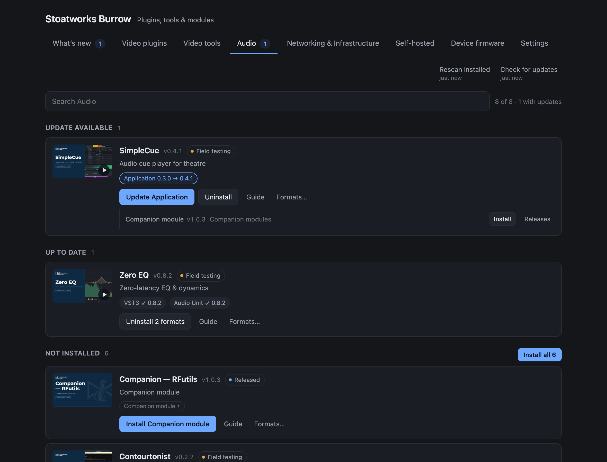
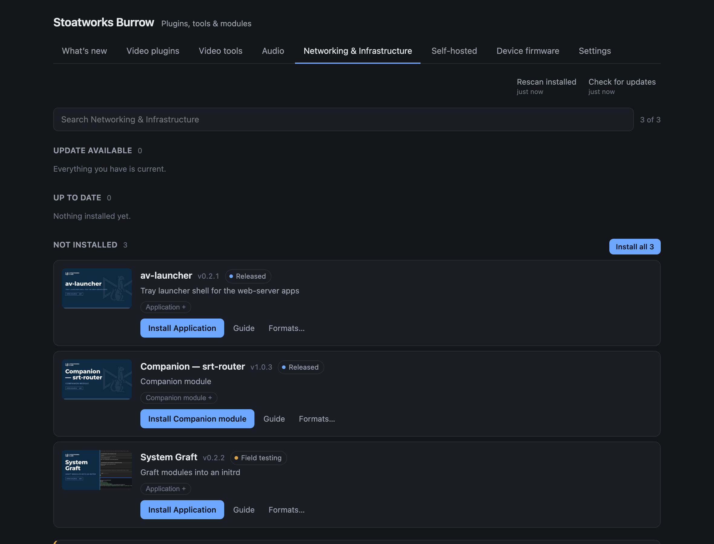
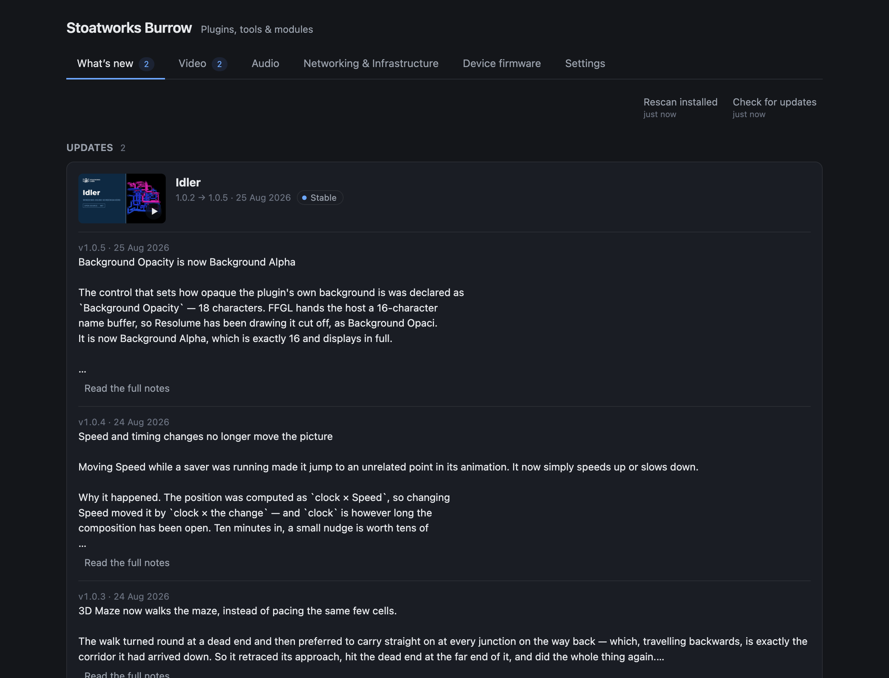
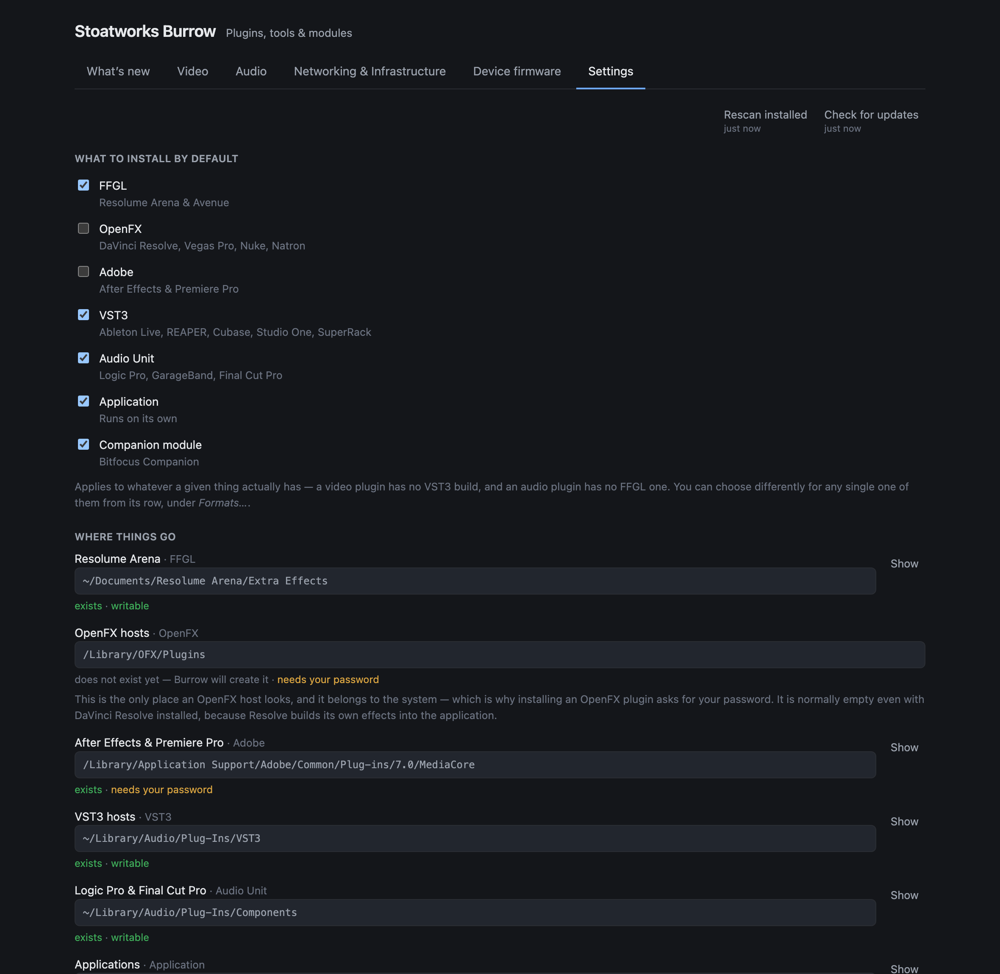
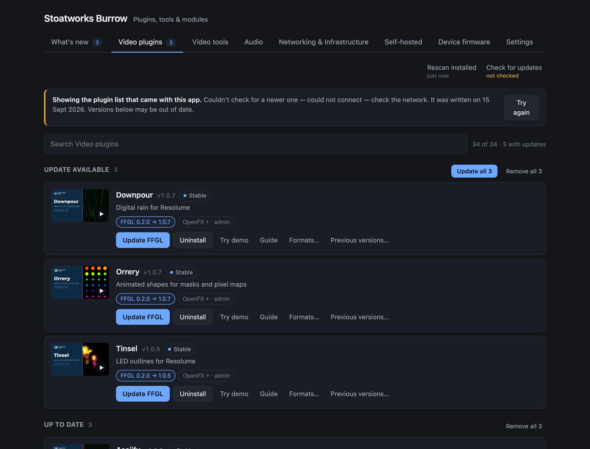

# Stoatworks Burrow

> **AI-assisted project.** This codebase was created with [Claude](https://claude.com/claude-code)
> (Anthropic), directed and reviewed by a human author. I've run the catalogue, the install
> and uninstall paths, the archive guards and the privileged helper's refusals against real
> release archives on macOS. **Nothing has been installed into a live host through the
> finished app yet.** The plugin folder work is checked against temporary directories, and
> the real `Extra Effects` folder is only ever *read*. The Windows privileged helper isn't
> written at all. Treat it as unfinished.

An optional desktop app that installs, updates and removes the
[Stoatworks](https://stoatworks-labs.com) plugins, tools and Companion modules.

It started with the twenty-five video plugins, which are the awkward ones. Most ship in
two or three formats (FFGL for Resolume, OpenFX for Resolve, Vegas, Nuke and Natron, and an
After Effects build), and installing one by hand means finding the project page, working out
which of six archives you want, unzipping it, and dragging a bundle into a folder that lives
somewhere different for every format and every platform.

It now covers the rest of the fleet the same way, under six tabs:

| | |
|---|---|
| **Video plugins** | The Resolume, Resolve and After Effects effects you load into a host. |
| **Video tools** | The applications you launch, and the Companion modules that drive them. |
| **Audio** | VST3 and Audio Unit plugins, and the audio tools that run on their own. |
| **Networking & Infrastructure** | The tools that move signals around a network and keep a rack running. |
| **Self-hosted** | The things you run rather than install: the services that ship as containers, and the browser tools. |
| **Device firmware** | Coming soon. |

A browser tool has nothing to install, so its row offers **Open** (the copy on the
website), **Source**, and, where the project ships a `docker-compose.yml`, **Run your
own**, which shows it with Copy and Save buttons. Every one with a compose file also
has an Unraid Community Applications template, in
[stoatworks-unraid](https://github.com/stoatworks-labs/stoatworks-unraid).

Applications get copied out of their disk image, and every tool that has a
[Bitfocus Companion](https://bitfocus.io/companion) module offers it on the same
row. Companion's own developer modules folder is just another destination.

Burrow is one searchable list instead of all that faff.

**Video:** [What it does, in 43 seconds](https://www.youtube.com/watch?v=NRaDQlkksXA)

<table>
  <tr>
    <td align="center"><br><sub>Video</sub></td>
    <td align="center"><br><sub>Audio &mdash; with a Companion module on its tool&rsquo;s row</sub></td>
  </tr>
  <tr>
    <td align="center"><br><sub>Networking &amp; Infrastructure</sub></td>
    <td align="center"><br><sub>What&rsquo;s new</sub></td>
  </tr>
  <tr>
    <td align="center"><br><sub>Settings</sub></td>
    <td align="center"><br><sub>Offline, saying so</sub></td>
  </tr>
</table>

*These are screenshots of the app itself, with the plugin names, versions and release notes
from the catalogue that ships inside it. What's shown as installed is staged with
[`scripts/screenshot.sh`](scripts/screenshot.sh), because several of these states are
awkward to produce on demand, and one of them is a cancelled password prompt.*

- **What's new:** release notes for updates you could take, and plugins you
  haven't seen.
- **Video plugins · Video tools · Audio · Networking & Infrastructure:** everything in
  that part of the fleet, under *Update available*, *Version unknown*, *Up to date* and
  *Not installed*, with per-format state on each row, and how far along each project is
  (*Field proven*, *Field testing*, *Stable*, *Released*, *Beta*, *In development*) in
  the same words the website uses.
- **Settings:** what to install by default, which you can override per item, and
  where each one goes.

Each plugin's video is the picture at the left of its row. Click it and it plays in the
window, streamed from the project's own GitHub release rather than embedded from YouTube,
so there are no cookies or ads and no third party involved. The stills ship with the app,
so the list works offline and nothing's fetched until you press play.

**Previous versions…** on any row rolls a plugin back to an earlier release,
which is handy when something starts misbehaving in the middle of show week.

There are two refresh controls, because they do different jobs. **Rescan installed**
re-reads your plugin folders without touching the network, and **Check for updates**
fetches the plugin list. Both tell you what they actually changed.

Every plugin's browser demo is **built in**: press *Try demo* and it runs locally,
offline, from an address only this app knows.

## No account, and nothing phoned home

There's no sign-in, because there's nothing to sign in to.

Burrow fetches one file, the plugin list at `stoatworks-labs.com/catalog.json`, and
downloads plugin archives and project videos from GitHub. That's the whole of its network
use. It doesn't send an identifier, a list of what you've installed, or any usage data. The
demos are served with no permission to make network requests at all.

Project videos stream from GitHub too, and only when you press play. The stills are
bundled, so the list itself fetches nothing.

Checking whether there's a **newer Burrow** adds one request, to Burrow's own GitHub
release, and it happens when you press the button in Settings. There's a checkbox to have
it ask at startup too, and it's off until you turn it on.

The *Send feedback* button at the bottom of the window is the only other thing that sends
anything. It only does it when you press it, and it only sends what you type into it.

## Claiming what you already installed

Burrow manages what it installed. An application or audio plugin you put there yourself is
invisible to it, because the catalogue doesn't declare payload names for those, so there's
nothing to look for.

**Settings → Software already on this machine** finds them by the bundle
identifier inside them, which the catalogue carries for every project. It doesn't go by
filename, so renaming a file gets it nowhere, and it only ever offers an identifier the
catalogue lists. Claiming one records it just as an install would, so from then on it
reports a version and takes updates. Releasing hands it back without touching the file.

The scan is the one place Burrow reads a folder it doesn't own, and all it ever produces is
a list to show you. Nothing's adopted until you pick it.

## Updating Burrow itself

**Settings → Burrow itself → Check for a new version.** If there is one, you get the release
notes before anything's downloaded, and *Install and restart* replaces this copy and
reopens it.

The download is checked against a signature made when the release was built, using a
public key compiled into the app. An update that doesn't match gets refused rather than
installed, which is why this is a button in the app and not a link to a file.

There are two situations it'll tell you about rather than fall over: a copy running from
inside the `.dmg` (that disk image is read-only, so drag Burrow to Applications first), and
a copy in a folder you don't have permission to write to. The check reports both before
anything is downloaded.

Nothing here happens on its own. Burrow doesn't check unless you press the button or turn
on the startup check, and it never downloads or installs anything without being told to.

## Installing things that need a password

Two formats out of seven do. FFGL plugins go into your own Documents folder, VST3s
and Audio Units into your own `~/Library/Audio/Plug-Ins`, Companion modules into a
folder you choose, and applications into `/Applications` if you can write there and
`~/Applications` if you can't. None of that needs anything special.

OpenFX and After Effects plugins go into system directories (`/Library/OFX/Plugins`
and Adobe's shared `MediaCore` folder), and there's nowhere a user can write that either host
will look in instead. So Burrow asks for an administrator password, **once per
batch**, and hands a small separate helper program a list of file moves to make.

That helper can't do anything else. It has no network client and no archive decoder
compiled into it, it'll only write inside a fixed list of plugin directories, and it'll
only delete a file it renamed itself moments earlier in the same operation. Everything
else (downloading, unpacking, checking) happens beforehand, without any elevated rights.

The unprivileged work always runs first, so if you change your mind at the password
prompt, the plugins that didn't need it are already installed.

## Status

**Beta, at v0.3.2.** v0.3.2 changes nothing you can see: it moves rustls, the TLS library
behind every download and the updater, to 0.23.46 for a medium-severity advisory
([GHSA-2mjx-qc3c-rqvc](https://github.com/advisories/GHSA-2mjx-qc3c-rqvc)). New at v0.3.1:
a plugin whose version Burrow can't read (a bare
FFGL `.dll`, or an OpenFX bundle with no `Info.plist`, which is every hand-installed plugin
on Windows) goes under its own *Version unknown* heading instead of being counted as *Up to
date*, and gets a *Reinstall* button (per row and in bulk) to put the current release in
place. v0.3.0 brought the browser tools' compose files into the catalogue's fifth tab, the
*Update available*-first ordering, the helper checking a plan against the user who
authorised it, and one universal macOS build with the sidecar and updater inside it.

What I've verified, on macOS:

- The catalogue builds from the live fleet data and serves correctly: 65 entries
  across the three categories, including the two plugins that publish no `latest`
  alias and would otherwise go missing.
- A real disk image (simpleVIS 0.4.0) mounts, gives up its `.app`, validates,
  installs and uninstalls against a temporary directory, with the version read back
  out of the bundle's `Info.plist`.
- Real release archives extract, validate, de-quarantine, install and uninstall
  against temporary directories, including downpour's two bundles and cartridge's
  archive of documentation and a command-line helper alongside the plugin.
- Scanning reads this machine correctly: twelve installed plugins with versions from
  their `Info.plist`, and every foreign bundle in the same shared folder stays
  invisible, as it should.
- The privileged helper refuses every hostile plan I gave it: traversal, a path
  outside the whitelist, a forged deletion nonce, a wrong owner, a loose file mode.

What I **haven't**:

- No plugin has been installed into a running Resolume, Resolve or After Effects
  through the app, and no audio plugin into a running DAW.
- No application has been installed into a real `/Applications`, and no Companion
  module into a real Companion.
- The macOS authorisation prompt has never been driven end to end.
- The quarantine clearing can't be proven from a local build. It needs a
  downloaded, Gatekeeper-quarantined copy of the app itself.
- Windows has no privileged helper, so OpenFX and Adobe installs are refused there
  with an explanation. FFGL isn't affected.

<!-- downloads:start -->

## Download

**[v0.3.1](https://github.com/stoatworks-labs/burrow/releases/tag/v0.3.1)** — prebuilt for macOS and Windows. Pick your platform:

<details>
<summary><b>macOS</b> — Universal (Apple Silicon + Intel)</summary>

| Build | Download | Size |
| --- | --- | --- |
| Universal (Apple Silicon + Intel) · .dmg disk image | [`burrow-0.3.1-macos-universal.dmg`](https://github.com/stoatworks-labs/burrow/releases/download/v0.3.1/burrow-0.3.1-macos-universal.dmg) | 26 MB |
| Universal (Apple Silicon + Intel) · .pkg installer | [`burrow-0.3.1-macos-universal.pkg`](https://github.com/stoatworks-labs/burrow/releases/download/v0.3.1/burrow-0.3.1-macos-universal.pkg) | 26 MB |

</details>

<details>
<summary><b>Windows</b> — x64</summary>

| Build | Download | Size |
| --- | --- | --- |
| x64 · .exe installer | [`Stoatworks.Burrow_0.3.1_x64-setup.exe`](https://github.com/stoatworks-labs/burrow/releases/download/v0.3.1/Stoatworks.Burrow_0.3.1_x64-setup.exe) | 12 MB |

</details>

Also in this release:

- [`burrow-0.3.1-macos-universal.app.tar.gz`](https://github.com/stoatworks-labs/burrow/releases/download/v0.3.1/burrow-0.3.1-macos-universal.app.tar.gz) — macOS app bundle (updater archive; the .dmg is the install), 26 MB

All builds, checksums and release notes: [github.com/stoatworks-labs/burrow/releases](https://github.com/stoatworks-labs/burrow/releases).

macOS builds are signed and notarised and open normally. The Windows builds are unsigned, so SmartScreen warns once.

<!-- downloads:end -->

## Building it

```bash
npm install
./scripts/sync-assets.sh    # catalogue, demos, thumbnails, the helper binary
npm run tauri dev
```

`sync-assets.sh` gathers what ships inside the app from the plugin repos and the
website checkout. It needs both sitting alongside this one, and the website built at
least once (`npm run build` there) so `dist/catalog.json` exists.

Tests:

```bash
cargo test --workspace
```

`cargo test --workspace` doesn't reach the Tauri shell, which is a standalone
workspace of its own. Run `cd src-tauri && cargo test` for the settings, demo server
and updater tests. CI runs both.

The interesting tests are in `crates/burrow-plan` (what the privileged helper will
refuse) and `crates/burrow-core` (reconciling the ledger against a real plugin
folder). Neither depends on Tauri, so they run on every platform in CI, including the
Windows paths I can't exercise by hand on a Mac.

To point the reconciliation logic at your own machine without a GUI:

```bash
cargo run -p burrow-core --example scan -- path/to/catalog.json
```

It only reads. It writes nothing.

## Make your own

Take the plugin names away and this is a desktop installer for software published as
GitHub releases. One JSON file lists what exists, and the app works out what you
already have, downloads the right archive for your platform, and puts each payload
where its host looks for it.

If that's how you ship things, fork it. **[docs/MAKE-YOUR-OWN.md](docs/MAKE-YOUR-OWN.md)**
covers the catalogue format, the handful of places this fleet's own names are
compiled in, and what to delete if you don't need the privileged helper or the
bundled demos.

## Licence

MIT, see [LICENSE](LICENSE).

<!-- attributions:start -->
This project is built on other people's work — see [ATTRIBUTIONS.md](ATTRIBUTIONS.md).
<!-- attributions:end -->
