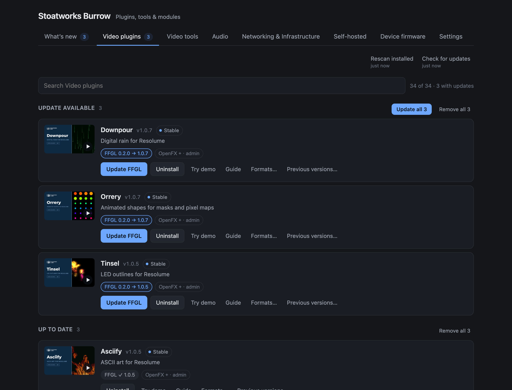

# Stoatworks Burrow user guide

Burrow is a desktop app that installs, updates and removes the Stoatworks plugins, tools
and Companion modules. It's one list with one click for each thing, and it knows where
every format goes on your machine.

> **Status at v0.4.1. Read this first.**
>
> I've tested Burrow thoroughly against real plugin downloads, but **no plugin
> has been installed into a running Resolume, Resolve or After Effects through
> it yet**. If you're about to use it before a show, don't. Try it on a machine where
> a broken plugin folder wouldn't cost you anything.
>
> **Updating Burrow itself arrived in v0.2.3**, the first release that publishes an
> update for the next one to find, and no copy has updated itself in the field yet.
> The download is signature-checked and refused if it doesn't match, and the .dmg and
> .pkg on this page are always there as the route that doesn't depend on any of it.
>
> On Windows it can install FFGL plugins for Resolume, but not OpenFX or After
> Effects plugins. That part isn't written yet, and it says so rather than
> half-working.
>
> Applications and Companion modules arrived in v0.2.0, and **no application has been
> installed into a real Applications folder through it yet**, nor a module into a
> real Companion.
>
> **The Device firmware tab is new, and no firmware has been written to a device by
> Burrow yet.** Not to a CANary, not to a PLAY. Its checks are tested hard without a
> device, but that isn't the same thing. Until this line says otherwise, write to a unit
> you can afford to have on the bench for an afternoon.
>
> This is an AI-assisted project, directed and reviewed by a human author.

---

## Installing Burrow

Download it from [the project page](https://stoatworks-labs.com/software/burrow/),
open the disk image and drag Burrow to your Applications folder. On Windows, run
the installer.



*The plugin list: update available, up to date and not installed, with the per-format state on every row.*

You don't need Burrow for anything. Every plugin can still be downloaded and installed
by hand, the same as before. Burrow just saves you doing it.

## The tabs

The fleet's bigger than the video plugins now, so it's split up by what each thing is
for:

| Tab | What's in it |
|---|---|
| **Video plugins** | The Resolume, Resolve and After Effects effects you load into a host |
| **Video tools** | The applications you launch, and the Companion modules that drive them |
| **Audio** | VST3 and Audio Unit plugins, and the audio tools that run on their own |
| **Networking & Infrastructure** | The tools that move signals around a network and keep a rack running |
| **Self-hosted** | Things you run rather than install — containers, and the browser tools |
| **Device firmware** | CANary firmware, BirdDog PLAY packages, and restoring a PLAY from its factory image |

An effect you load into Resolume is a different errand from an application you
launch, which is why the video ones are two tabs rather than one.

A number beside a tab is how many things in it need updating.

## The first thing you'll see

Burrow reads your plugin folders and shows you what you've already got. It doesn't
change anything until you tell it to.

There are four headings, in the order they need your attention:

- **Update available:** you have it, and there's a newer version.
- **Version unknown:** you have it, but nothing on disk says which version, so Burrow
  can't tell whether it's current.
- **Up to date:** you have it, and it's current.
- **Not installed:** it's available, and you don't have it.

Each row shows which **formats** that plugin comes in and what you have of each:

| What you see | What it means |
|---|---|
| `FFGL ✓ 1.0.2` | Installed, current |
| `FFGL 1.0.1 → 1.0.2` | Installed, and there's an update |
| `OpenFX +` | Available, not installed. Click it to install just that one |
| `OpenFX + · admin` | Same, but it will ask for your password |
| `FFGL ? version unknown` | It's installed, but nothing on disk says which version |
| `Adobe —` | No build of this plugin for that host |

Beside the version, each row says **how far along that project is**, using the same
status the website gives it, in the same words:

| | |
|---|---|
| **Field proven** | Released, and run on real events — not just verified on the bench |
| **Field testing** | Out of the lab and being used in real conditions — not yet trusted blind |
| **Stable** | Tagged 1.0 builds: the feature set and the controls have settled |
| **Released** | Tagged builds you can download and run |
| **Beta** | Tagged builds you can download and run, but early: the controls may still move, and it has met few hosts |
| **In development** | Working, moving, not yet tagged |

Hover over it to see the same sentence. It's worth reading before a show: *Field
testing* and *In development* mean what they say.

### Doing a whole heading at once

Each heading has buttons for the plugins underneath it (**Update all**, **Reinstall all**,
**Install all**, **Remove all**), and each one does what the button on every row under it
would do, for all of them at once. They only appear when there's more than one row to act
on. With a single row, its own buttons are right there.

They act on what you can see. If you've typed in the search box, the count on the
button is the number that survived the search, and those are the only ones that'll
be touched.

**Install all** and **Remove all** ask first, and tell you how much there is to
download or what's about to be deleted. **Update all** doesn't ask, because it only
brings what you already chose up to date.

### While it's working

A strip across the top of the window says what Burrow is doing for as long as it's doing
it, whichever tab you're on: which plugin, how far through the batch and how far through
that step (*Installing 3 of 12 · Abomerration (FFGL) · Downloading · 12.3 MB of 40.1 MB*),
then *Waiting for your password* if anything needs it. Afterwards it says *Checking what
is installed* while Burrow re-reads your plugin folders, which for an application means
hashing it and takes a moment. The window keeps answering throughout. Before v0.4.0 it
could stop answering during that last part, which looked exactly like a crash.

**Cancel** is there while Burrow is still downloading. It downloads everything first and
installs it second, so pressing Cancel stops the downloads. Anything already downloaded
that doesn't need your password is still installed. Anything that does need it isn't,
and nothing asks you for it. Once the first plugin has started going into place there's
no button, because a half-copied plugin folder is worse than a finished one.

**"Version unknown" isn't a fault.** On Windows a plugin is a bare `.dll` with no
version in it, so Burrow really can't tell. It'll offer to reinstall the current
version rather than pretend to know. It also happens on macOS if you built a plugin
yourself, or installed one before you had Burrow.

## Keeping it current

There are two buttons above the list, because they do different jobs:

**Rescan installed** re-reads your plugin folders. It doesn't use the network at all,
so it works offline and it's instant. Press it after installing or removing a plugin
by hand, and Burrow will notice without needing to be told twice.

**Check for updates** fetches the plugin list. This is the one that finds new
versions and new release notes, and the only one that goes anywhere.

Both tell you what they actually did (*"2 new versions · 1 now needs updating"*, or
*"Nothing changed"*), and each shows when it last ran. If the version numbers
you're looking at came from the copy that shipped with the app rather than a
live check, the second button says **not checked** instead of a time.

## Self-hosted

Some of this software doesn't get installed at all. You run it.

**Self-hosted** holds two kinds of thing: the tools that ship a
`docker-compose.yml` (flock, SRT Router, ATEM Overseer and the rest), and the
browser tools that already run on the website. They're together because they raise
the same question: *how do I run this?*

A browser tool has nothing to install, so its row offers **Open** (the copy running
on the website) and **Source**. Where it ships a compose file there's also **Run your
own**, which shows you the file with Copy and Save buttons, so you can host it
yourself instead of using mine.

Eight of the container tools are also desktop applications: LivePremier Plus,
BlackMatrix, flock, SRT Router, ATEM Overseer, atem-scopes, Aquilon VPU Map and
RFutils. Their rows install and update the app like any other row, with **View
compose** beside it for when you'd rather run it in a container.

**Before v0.4.1 this tab was always empty.** Burrow misread the tab's name in the
catalogue, so everything filed here showed on no tab at all, and those eight apps
were only reachable from *What's new*. If you've had one installed since then,
this is the first time Burrow has shown it to you.

## Device firmware

This tab writes to devices, not folders, and it behaves differently because of that.
Nothing happens when you open it: no device is looked for and nothing is downloaded
until you press a button. Every write shows you exactly what goes where and waits
for you to say yes. Once it's started it can't be cancelled, because stopping halfway
through a partition is worse than finishing it.

### CANary

Plug the unit in by its USB-C port and press **Look for a unit**, then **Read it**.
Reading a unit restarts it, because opening that port resets the ESP32-S3, so don't
do it to one that's running a show. You'll see its chip, its MAC address, how much
flash it has and which firmware it boots.

Pick **Standard** (the Ethernet bridge, with the USB-C port left as a serial console)
or **USB network** (the same, plus a settings page over the cable), and **Write**.
With *Keep this unit's settings* ticked, which is the default, only the four regions a
release carries are written, and the unit keeps its name, port and LAN address. Untick
it and the whole flash is erased first.

Burrow won't write to a unit with less than 8 MB of flash, a chip that isn't an
ESP32-S3, or secure boot or flash encryption turned on. If the unit is running
something that isn't CANary firmware, or nothing readable at all (a blank board looks
like that), it says so and asks you to tick a box before it'll replace it.

**If a write fails, the unit isn't bricked.** The ESP32-S3's boot ROM can't be
overwritten: hold BOOT, tap EN, press *Look for a unit* again and write it again.

A unit on the **USB network** firmware turns its USB-C port into a network adapter
8 seconds after it starts, and from then on there's no serial port to find. Either
look for it within those 8 seconds of plugging it in, or hold BOOT, tap EN, let go of
BOOT, and look then.

**Write your own build** takes the `.bin` files from an ESP-IDF build. They're placed
by what they are, not by what they're called, and an app that isn't a CANary build
needs a box ticking.

### BirdDog PLAY packages

**Set up a package** fetches the patcher kit (about 30 MB, from GitHub), and then it's
the [PLAY Patcher](https://birddog-play-patcher.stoatworks-labs.com) without the
browser: paste an SSH public key, tick what you want (Tailscale, the NDI KVM
endpoint, the USB media player, the UVC converter, the streaming gateway), add your
own modules if you have any, and **Build the package**. Tailscale comes from
Tailscale's own download server and is checked against the SHA-256 they publish. The
streaming gateway's MediaMTX comes from its GitHub release, checked the same way.

Then either **Save** it and upload it from BirdUI's System page under *System
Update*, or **Send to a PLAY**: type its address and the BirdUI password, and Burrow
logs in, uploads it the way the System page does, and waits up to ten minutes for the
unit to come back. That's plain HTTP, because it's all BirdUI speaks. The password is
used for that one send and isn't kept.

Installing a package won't do your warranty any favours. Treat the first one as an
experiment on a unit you can afford to have offline.

### Restoring a PLAY

This is the [PLAY Flasher](https://birddog-play-flasher.stoatworks-labs.com) without
the browser. It needs **your own copy** of BirdDog's factory image (`PLAY_1.0.30.img`,
from their reimage instructions). Burrow doesn't ship or download BirdDog's software,
including the loader inside that image.

1. Power the PLAY off.
2. Push a paperclip into the 3.5 mm headphone socket (the recovery button is inside
   it) and hold it.
3. Apply power, still holding, and connect its USB-C port to your computer.
4. Let go, then **Choose a factory image** and **Look for a PLAY**.

**Erase and write** wipes the unit completely, including its serial, its hostname and
everything under `/userdata`, and writes the image. Choose a package to go with it and
the PLAY installs it on its first boot, then restarts again, so give it a few minutes
before expecting video. A unit in *maskrom* has the loader from your image started
first; one already in *loader mode* doesn't need it.

With *read back what can be read* ticked, Burrow checks what it wrote. A PLAY returns
filler rather than data above a certain point on its storage, whatever is there, so
anything past that point is reported as *not read back* rather than as a failure. That's
the device, not the write.

**Write partitions** (loader mode only) puts named image files into the matching
partitions, found in the unit's own partition table, and leaves everything else alone.
`uboot`, `trust` and `recovery` are how the unit gets recovered, so writing one of those
needs a box ticking.

If a restore fails, leave the unit in recovery mode and write it again. That's what
recovers it.

**On Windows** the PLAY needs the WinUSB driver, which [Zadig](https://zadig.akeo.ie)
puts on: pick the Rockchip device, choose WinUSB, *Replace Driver*. Burrow tells you
when it's missing and doesn't install drivers itself. Windows on ARM can't do this at
all.

Not affiliated with, endorsed by or supported by BirdDog. BirdDog is a trademark of
its owner.

## Software you installed yourself

Burrow only manages what it installed. If you already had one of these
applications or audio plugins on the machine, it'll say **not installed** and
offer you a download, because an application doesn't carry a name Burrow is looking
for, so it can't see it.

**Settings → Software already on this machine → Look for it.** Anything it
recognises is listed with the file, the folder it's in, and the version. Press
**Claim** and it tells you what that means before you confirm: Burrow records the
file as its own, will replace it when there's an update, and will delete it if you
uninstall, the same as anything it installed itself.

It recognises things by the identifier inside the bundle, not by the filename, so
renaming a file won't fool it, and nothing that isn't mine can be offered by
accident. On Windows there's no identifier to read, so a claim there is taking your
word for it, and Burrow says so on the row.

**Release** undoes a claim. It only makes Burrow forget the file. Nothing is
moved or deleted.

## Updating Burrow itself

Those two buttons are about the *plugins*. Burrow's own version is in
**Settings**, under **Burrow itself**, with a **Check for a new version**
button beside it.

If there is one, you get the version, the date and the release notes before
anything is downloaded, and **Install and restart** does what it says: it
replaces this copy and reopens it. There's a **Check when Burrow starts**
checkbox if you'd rather be told at launch. It's off until you turn it on,
and even then nothing is downloaded or installed until you press the
button.

The download is checked against a signature made when the release was built. One
that doesn't match is refused rather than installed.

There are two things it'll tell you instead of updating, and both are about where
this copy of Burrow is:

- **Running from the disk image.** If you opened Burrow from inside the `.dmg`
  rather than dragging it to Applications, that disk is read-only and nothing
  can replace it. Drag it across and update from there.
- **In a folder you can't write to.** Most likely `/Applications` on a machine
  where you're not an administrator. Burrow offers the download page instead.

## Watching a plugin before you install it

Every plugin's video is the picture at the left of its row. Click it and the
video plays in the window.

The still images are part of the app rather than fetched from YouTube, so the list
works offline and browsing plugins tells Google nothing. Only pressing play loads
anything, and only for that one video.

It plays from the project's own GitHub release (the same place its plugins come
from) rather than a YouTube embed. So there are no cookies, ads or suggested videos
afterwards, and nobody outside this app and GitHub knows you watched it. There's an
**Open on YouTube** button if you'd rather watch it there.

The videos are about 11 MB each and start playing while they download. A couple
of plugins don't have a copy in the app yet, and clicking those opens YouTube in your
browser instead.

## Formats, and which ones you want

Most plugins come in more than one format. They're the same effect; the format is
just which application loads it.

| Format | For |
|---|---|
| **FFGL** | Resolume Arena and Avenue |
| **OpenFX** | DaVinci Resolve, Vegas Pro, Nuke, Natron |
| **Adobe** | After Effects and Premiere Pro |
| **VST3** | Ableton Live, REAPER, Cubase, Studio One, SuperRack |
| **Audio Unit** | Logic Pro, GarageBand, Final Cut Pro |
| **Application** | Nothing — it runs on its own |
| **Companion module** | Bitfocus Companion |

In **Settings**, tick the ones you use. Burrow starts with everything that needs no
password ticked, and OpenFX and Adobe left off, as those are the two that do.

Nothing comes in every format: a video plugin has no VST3 build and an audio plugin
has no FFGL one, so ticking a format you never use costs you nothing.

You can override this for a single plugin from its row with **Formats…**, if there's
one you want in Resolve but not Resolume, or the other way round. A row with its
own choice shows a small **custom formats** label so you can see at a glance that
it isn't following your defaults.

## Companion modules

A tool that has a Bitfocus Companion module shows it on the tool's own row, below
the buttons: *Companion module v1.0.1*, with **Install** beside it.

Companion has no fixed folder for modules that aren't in its store. It reads the
one you name in **Settings → Developer modules path**, so:

1. Install the module in Burrow. It goes to `Documents/Companion Modules` unless
   you tell Burrow otherwise, in Settings → *Where things go*.
2. Point Companion's Developer modules path at that folder.
3. **Restart Companion.** It reads that folder once, when it starts.

Already got a modules folder? Change the path in Burrow's Settings to yours and
step 2 is done.

## Applications

Applications install straight into your Applications folder, or, if you're not an
administrator on this machine, into your own `~/Applications`, which Spotlight and
Launchpad index just the same. Either way it never asks for a password.

On Windows they go into `%LOCALAPPDATA%\Programs`, and **no Start-menu shortcut is
created**: Burrow places the program folder and doesn't write anywhere else. Make a
shortcut yourself if you want one.

## Why it asks for your password

Two of the seven formats need it, and the rest never do. FFGL plugins go into your own
Documents folder, VST3s and Audio Units into your own `~/Library/Audio/Plug-Ins`,
Companion modules into a folder you chose, and applications as above. Burrow doesn't
need anything special for any of those.

OpenFX and After Effects plugins are different. They go into folders that belong
to the system:

```
OpenFX     macOS    /Library/OFX/Plugins
           Windows  C:\Program Files\Common Files\OFX\Plugins
Adobe      macOS    /Library/Application Support/Adobe/Common/Plug-ins/7.0/MediaCore
           Windows  C:\Program Files\Adobe\Common\Plug-ins\7.0\MediaCore
```

There's no alternative: those are the only places those applications look. So
Burrow asks for an administrator password **once**, however many plugins are in
the batch, and only when the batch actually needs it.

I've kept what happens behind that prompt as small as I could. Burrow downloads,
unpacks and checks everything *first*, with no special rights at all. Only then
does it hand a separate helper program a list of files to move, and that helper
can't do anything else. It has no way to reach the network and no way to open an
archive, it'll only write into the plugin folders above, and it'll only delete
a file it moved aside itself seconds earlier.

**If you change your mind at the password prompt, nothing is lost.** Anything in
that batch that didn't need a password is already installed, and the rest is
reported as cancelled, not as an error.

## `/Library/OFX/Plugins` is empty, and that's normal

If you have DaVinci Resolve installed and Burrow tells you there are no OpenFX
plugins, nothing's wrong. Resolve builds its own effects into the application
rather than installing them as separate plugins, so that folder is usually empty
(and often doesn't exist at all) on a machine that uses Resolve every day.

Burrow will create it the first time you install an OpenFX plugin.

## After installing

**Restart the host.** Resolume, Resolve and After Effects all read their plugin
folders at startup. A plugin installed while they're running won't appear
until they're restarted, and in Resolume you may also need to rescan effects.

If a plugin still doesn't appear, the likeliest cause on macOS is the quarantine
flag, which makes Resolume skip a plugin *silently* rather than telling you.
Burrow clears it on everything it installs, so this shouldn't happen, but if it
does, please [report it](https://github.com/stoatworks-labs/burrow/issues).

## Trying a plugin before you install it

Press **Try demo** on any row. The plugin's browser demo opens in a window,
running the plugin's own shaders, with nothing to install and nothing sent anywhere.
Every demo is built into Burrow, so this works with no internet connection at all.

A few plugins have no demo: Cartridge needs an emulator core you supply yourself,
and Amber and nib are too new. Those rows have no **Try demo** button rather than
a button that does nothing.

## Going back to an earlier version

If a new version misbehaves, **Previous versions…** on the row rolls it back.
Burrow keeps the last few releases of every plugin, with a link to each one's
notes.

It only offers this for formats you already have installed. Rolling back is for
repairing something you have, not for getting something you don't.

Afterwards the plugin will show an update available, because there will be one.
Restart your host to pick the change up.

## Uninstalling

**Uninstall** on any row removes what Burrow installed, and nothing else. That
includes formats with an update waiting (a plugin you haven't updated yet is still
a plugin you have), and the button removes every format of it you have on disk. It
tells you how many when there's more than one.

Your plugin folder almost certainly has other things in it: plugins from other
people, examples that came with an SDK, your own builds. Burrow doesn't look at
them, doesn't list them, and can't remove them. It only ever touches files it
knows belong to a plugin in its own list.

If you installed a plugin by hand before you had Burrow, it can still remove it,
but it'll tell you which files it's going to delete first.

## What Burrow sends

There's no account and no sign-in, because there's nothing to sign in to.

Burrow fetches one file (the plugin list from `stoatworks-labs.com`) and
downloads plugin archives and project videos from GitHub. That's all. It doesn't
send an identifier, a list of what you've installed, or any usage data, and there's
no third party involved anywhere. The demos run from inside the app and are
blocked from making any network request at all.

Checking for a new Burrow is one more request, to Burrow's own GitHub release,
asking what the current version is. It happens when you press the button, and
at startup as well if you ticked that box. Nothing about your machine goes with
the question.

The *Device firmware* tab adds two more, both only when you ask. Building a PLAY
package with Tailscale in it fetches Tailscale from `pkgs.tailscale.com`. Sending a
package to a PLAY talks to that PLAY at the address you typed, with the password you
typed. Firmware itself comes from GitHub like everything else, and Burrow won't write
it unless its bytes match the SHA-256 the plugin list gives for it.

The **Send feedback** button at the bottom of the window is the exception, and only
when you press it: it sends what you type, plus the version of Burrow.

## When it can't reach the internet

Burrow works offline. It ships with a copy of the plugin list, so it can still
show you everything and tell you what you've got installed.

It'll tell you when it's doing that, with a banner reading *"Showing the plugin list
that came with this app"*, because version numbers from a list written weeks ago
aren't the same claim as version numbers checked a minute ago, and you should be
able to tell which you're looking at. Installing still works, as the downloads come
from GitHub.

## If something goes wrong

Errors appear on the row they belong to, saying what actually failed, and stay there
until you do something about them. Nothing disappears into a notification you
might have looked away from.

A failed install leaves your plugin folder just as it was. Burrow never writes
into a live plugin file: it unpacks and checks everything somewhere else first,
and only then swaps the finished result into place. If that swap fails partway through
a plugin with more than one component, it puts back the ones it had already done.

For anything else, [open an issue](https://github.com/stoatworks-labs/burrow/issues)
or use **Send feedback** in the app.
